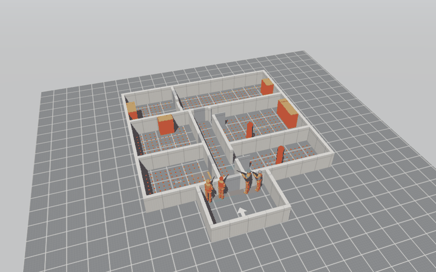
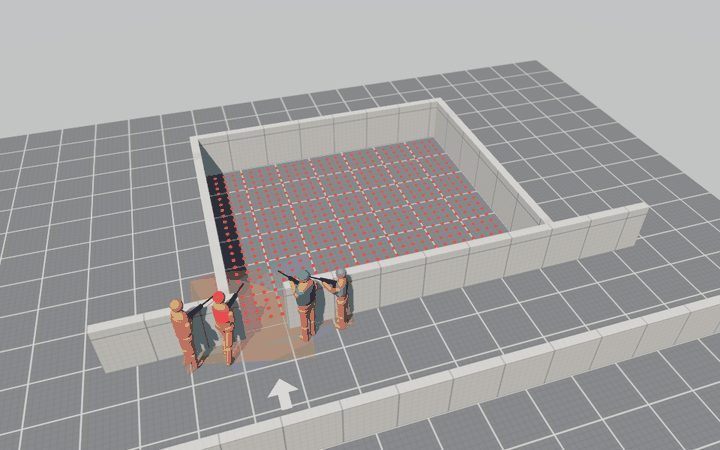

# cqb-research

**How strongly do comparisons of coordinated multi-agent search strategies depend on model
assumptions, information access and the evaluation protocol?**

A research simulator for coordinated search under visibility constraints. The case study:
stylized models of published close-quarters room-entry techniques, compared with the best
strategies an optimizer finds in the same model. Status: **exploratory research code**,
not a validated tactical model. See [Scope and ethics](ETHICS.md).

| Apartment clearing (3D greybox viewer) | Single-room entry, stylized technique vs. best found (ghost) |
|---|---|
|  |  |

## What is in here

- **Geometry:** rooms with door channels and wall thickness; generated apartments with a
  hallway, door swing, closed doors, furniture and a kitchen pass-through; line of sight via
  precomputed visibility.
- **Agents:** four operators with individual body sizes and speeds, a gaze turn-rate limit,
  a vision cone and a perception dwell time.
- **Threat model:** an abstract duel. Hidden threats react, hit at a rate, and are neutralized
  only after detection and identification. Several threats per scenario. No ballistics.
- **Techniques:** 8 stylized encodings with source and status
  ([TACTICS.md](docs/TACTICS.md)); team sizes 2-4; execution noise.
- **Optimization:** cross-entropy search in the same plan space, Pareto archive, planning vs.
  held-out threat scenarios, one pre-selected candidate per technique (no winner's curse).
  Optional batched GPU evaluation (PyTorch).
- **Analyses:** sensitivity, robustness to execution noise, an adversary who knows the plan
  (price of predictability).
- **Viewer:** a self-contained three.js page with ghost overlay, cutaway walls, threat markers
  and door states.

## Quickstart

```bash
python -m uv sync                      # numpy-only; add --extra gpu for the PyTorch backend
python -m uv run pytest
python -m uv run killhouse-bench --quick --rooms M-center --out out/demo   # report.html + viewer3d.html
python -m uv run killhouse-apartment --seeds 5 --out out/apartment         # apartment + viewer3d.html
```

## Research state

| document | content |
|---|---|
| [BIG_PICTURE](docs/BIG_PICTURE.md) | goal, status, main findings, weaknesses |
| [CLAIMS](docs/CLAIMS.md) | every claim with status (supported / hypothesis / retracted) and evidence |
| [PARAMETERS](docs/PARAMETERS.md) | provenance of every model parameter (empirical / geometric / free) |
| [PREREG_E1_draft](docs/PREREG_E1_draft.md) | draft preregistration (not frozen) |
| [RUNLOG](docs/RUNLOG.md) | which results were known at which model state |
| [REVIEW_R1](docs/REVIEW_R1.md), [R2](docs/REVIEW_R2.md), [R3](docs/REVIEW_R3.md) | AI-assisted methodological reviews and responses |
| [ROADMAP](docs/ROADMAP.md) | stages and milestones |

All findings so far are **exploratory and model-internal**. Most parameters are free
modelling choices; technique names denote stylized movement models, not verified procedures.
Two reviews found real methodological errors (an information leak and a selection bias); both
are fixed and documented.

## Licence

No licence has been chosen yet. Until then, the default copyright applies.
