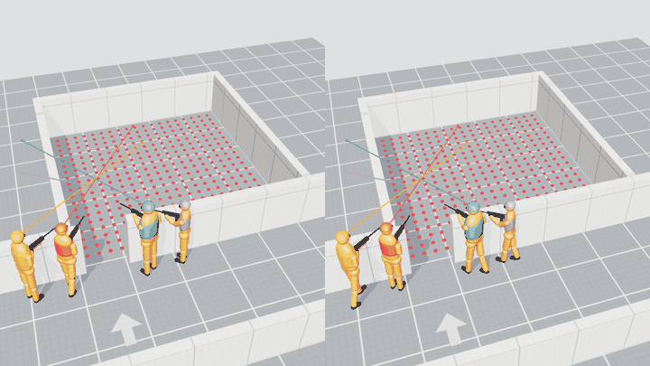

# cqb-research

**How strongly do comparisons of coordinated multi-agent search strategies depend on model
assumptions, information access and the evaluation protocol?**

A research simulator for coordinated search under visibility constraints. The case study:
stylized models of published close-quarters room-entry techniques, compared with the best
strategies two optimizers find in the same model. Status: research code with one preregistered
study, **not** a validated tactical model. See [Scope and ethics](ETHICS.md).

| Apartment clearing (3D greybox viewer) | Single-room entry, stylized technique vs. best found (ghost) |
|---|---|
|  |  |

Research viewer (v0.3 in progress): a technique and the best strategy found, side by side, with
animated figures and their attention direction.



## Result of the first confirmatory study (E1)

Preregistered and frozen before the run ([PREREG_E1](docs/PREREG_E1_draft.md), tag `e1-prereg`),
evaluated once on 40 held-out rooms ([REPORT_E1](docs/REPORT_E1.md)). Both hypotheses passed,
within this abstract model:

- At equal room width, the optimizer improves on crisscross by 10.7 points more for corner-fed
  doors than for centre-fed ones (95 % CI 6.3-14.8).
- Where both are valid, crisscross has lower risk than buttonhook in 23 of 31 rooms (74 %).

The methodological finding: two optimizer families disagreed by more than 5 points in 35 % of
the cases, so how a technique compares with the "best found" strategy depends noticeably on the
search method.

**How it got there:** reference cases with known solutions, a seed and budget saturation study,
a second optimizer family, a dress rehearsal on 40 development rooms, four methodological reviews
and pre-freeze checks whose rules were committed before measuring. Two reviews found real errors
(an information leak and a selection bias); both are fixed and documented.

## Reproduce E1

```bash
python -m uv sync --extra gpu        # or without --extra gpu: numpy only, slower
python -m uv run pytest
git checkout e1-prereg               # the frozen state
python -m uv run killhouse-bench --generated 2026 40 --iters 60 --pop 64 --seeds 5 --optimizer cem cmaes --out out/e1
python -m uv run killhouse-analyze out/e1/results.json --generated 2026 40
```

The run takes about 4 h on a mid-range consumer GPU. The archived results are in
[`data/e1`](data/e1) (unpack `results.json.gz` and pass it to `killhouse-analyze`).

## What is in here

- **Geometry:** rooms with door channels and wall thickness; generated apartments with a
  hallway, door swing, closed doors, furniture and a kitchen pass-through; line of sight via
  precomputed visibility.
- **Agents:** four operators with individual body sizes and speeds, a gaze turn-rate limit,
  a vision cone and a perception dwell time.
- **Threat model:** an abstract duel. Hidden threats react, hit at a rate, and are neutralized
  only after detection and identification. Several threats per scenario. No ballistics.
- **Techniques:** 8 stylized encodings with source and status
  ([TACTICS.md](docs/TACTICS.md)); team sizes 2-4; execution noise.
- **Optimization:** cross-entropy search and CMA-ES in the same plan space, pooled archives,
  planning vs. held-out threat scenarios, one pre-selected candidate per technique. Optional
  batched GPU evaluation (PyTorch).
- **Analyses:** preregistered analysis plan as code, sensitivity, robustness to execution noise,
  an adversary who knows the plan (price of predictability).
- **Viewer:** a self-contained three.js page with ghost overlay, cutaway walls, threat markers
  and door states.

## Quickstart

```bash
python -m uv sync
python -m uv run killhouse-bench --quick --rooms M-center --out out/demo   # report.html + viewer3d.html
python -m uv run killhouse-apartment --seeds 5 --out out/apartment         # apartment + viewer3d.html
```

**North star:** an open reference platform for coordinated search under limited visibility. It
should make spatial planning comparable, explain why methods fail, and test whether results
transfer to new environments and assumptions ([BIG_PICTURE](docs/BIG_PICTURE.md)).

## Research state

| document | content |
|---|---|
| [BIG_PICTURE](docs/BIG_PICTURE.md) | goal, status, main findings, weaknesses |
| [CLAIMS](docs/CLAIMS.md) | every claim with status (confirmed / supported / hypothesis / retracted) and evidence |
| [PREREG_E1](docs/PREREG_E1_draft.md) | preregistration of study E1, frozen at tag `e1-prereg` |
| [REPORT_E1](docs/REPORT_E1.md) | confirmatory study E1 on 40 held-out rooms |
| [REPORT_G1_rehearsal](docs/REPORT_G1_rehearsal.md) | dress rehearsal of E1 on 40 development rooms |
| [REPORT_M2](docs/REPORT_M2.md) | method check: reference cases with known solutions, seed x budget saturation |
| [PARAMETERS](docs/PARAMETERS.md) | provenance of every model parameter (empirical / geometric / free) |
| [RUNLOG](docs/RUNLOG.md) | which results were known at which model state |
| [REVIEW_R1](docs/REVIEW_R1.md), [R2](docs/REVIEW_R2.md), [R3](docs/REVIEW_R3.md), [R4](docs/REVIEW_R4.md) | AI-assisted methodological reviews and responses |
| [ROADMAP](docs/ROADMAP.md) | stages and milestones |
| [CHANGELOG](CHANGELOG.md) | releases |

All findings are **model-internal**, and all except the two E1 tests are exploratory. Most
parameters are free modelling choices; technique names denote stylized movement models, not
verified procedures.

## Licence

[MIT](LICENSE). If you use the code or the results, please cite it ([CITATION.cff](CITATION.cff)).
